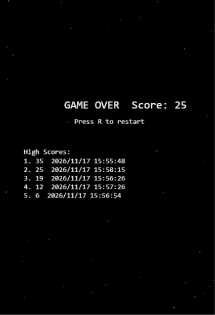
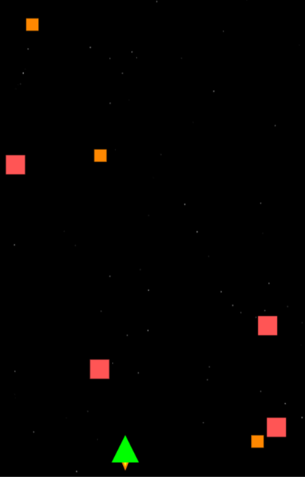

# Space Dodger

A 2D space shooter built with vanilla JavaScript and HTML5 Canvas. No dependencies.

## Play

[Live Demo](https://enfren.github.io/vanilla-js-space-dodger/)

## Screenshots

| Gameplay | Game Over |
|----------|-----------|
|  |  |

## Controls

| Key | Action |
|-----|--------|
| ← → | Move ship |
| Space | Fire |
| R | Restart (after game over) |

## Features

- Particle explosions
- Scrolling starfield
- Procedural sound effects (Web Audio API)
- Difficulty ramp after score 100
- Top-10 high scores with date/time (localStorage)
- Multiple obstacle types with varying HP

## Tech

Single HTML file. No build step, no frameworks, no dependencies.   
